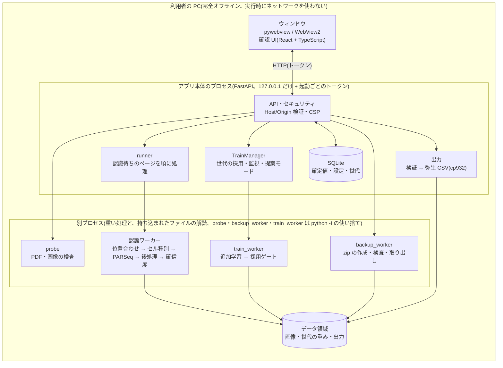

# Yayoi OCR — 手書き経理帳票 → 弥生会計 CSV

手書きの経理帳票(A4・1 様式)のスキャン画像・スマホ写真を文字認識し、弥生会計へ取り込める CSV に変換する
Windows 向け・完全オフラインのアプリです。書き手本人の字形を、確認フェーズで確定した結果から逐次学習して
精度を上げていきます。

> **このリポジトリは public です。** サンプル画像・切り出し画像・正解データ・学習データ・モデルは
> **絶対にコミットしません**(後述)。

## 全体像



流れ: 帳票(PDF・画像)を取り込む → 認識(要確認の印つき)→ 利用者が確認して確定 → 弥生インポート形式の CSV を出力。確定したページは次の認識に使われ、貯まると裏で追加学習して「世代」を作る。
新しい世代は、学習に使わなかった確定ページで試し、見逃しが増えないときだけ採用する(採用後も監視し、悪化すれば自動で前の世代に戻す)。
利用者が持ち込んだファイル(PDF・画像・バックアップの zip)の解読は、トークンと DB を持つ本体のプロセスでは行わず、使い捨ての別プロセスで行う。

## 開発状況

| Phase | 内容 | 状態 |
|---|---|---|
| 0 | 骨組み・データモデル・様式テンプレート・合成帳票生成器(書き手シミュレーション) | 完了 |
| 1 | 前処理・表の位置合わせ・セル切り出し(`docs/layout.md`) | 完了 |
| 2 | 認識(セル種別・PARSeq・後処理・見覚えメモリ・確信度の較正。`docs/recognition.md`) | 完了(数字専用の R2 は、実データの N≥50 がそろうまで保留) |
| 3 | 確認フェーズ(Web UI。`docs/phase3_design.md`) | 完了 |
| 4 | 追加学習(世代管理・採用ゲート・監視と自動ロールバック・提案モード。`docs/phase4_design.md`) | 完了 |
| 5 | 弥生 CSV 出力(`docs/yayoi_export.md`) | 完了(試用版。弥生の実環境での取り込みは未確認) |
| 6 | 配布(Windows のセットアップ・ログ・ライセンス表示・手引き・バックアップ・アンインストール。`docs/phase6_packaging.md`) | 試用版の RC 作成済み(`docs/trial_rc.md`、未公開)。Windows 実機の確認は未実施 |

試用版の公開は、利用者の承認を待っている。文書の一覧は `docs/README.md`。

## セットアップ

```sh
python -m venv .venv && . .venv/bin/activate     # Python 3.11 以上
pip install -e ".[dev]"
sh scripts/install_hooks.sh                       # 実データ混入チェックの git フックを有効化
```

## 実データの置き場所

実データは **リポジトリの外** の `YAYOI_PRIVATE_DATA`(既定 `~/yayoi_private`)に置きます。
開発中は実データの内容を一切扱いません(サンプル画像は様式のレイアウト実測・セル境界の目視検証にだけ使い、
文字の読み取り・学習・評価には使わない)。実際の帳票での学習は、納品後にユーザーの PC 内で行います。

```
$YAYOI_PRIVATE_DATA/
  samples/        # サンプル画像
  fonts/          # 合成帳票用の手書き風フォント(scripts/fetch_fonts.py で取得。コミットしない)
  debug/          # 重ね描き画像・切り出し画像などのデバッグ出力
```

コード・テスト・ドキュメント・コミットメッセージに実データの値(実際の摘要・取引先・金額など)を書かないでください。
テスト・評価はすべて、実行時に合成した架空の帳票(`yayoi_ocr.synth`)で行います。

## 使い方(開発用 CLI)

```sh
python -m yayoi_ocr.cli layout <画像> --out <出力先>
```

画像の向きと傾きを補正し、表の罫線を 1 本ずつ追跡してセルを切り出します。出力先には
重ね描き画像(`overlay.png`)、正準化したページ画像、セルごとの切り出し画像、`layout.json` が書かれます。
**出力先はリポジトリの外**(`YAYOI_PRIVATE_DATA` 配下など)にしてください(リポジトリ内は拒否されます)。

## 合成帳票(テスト・評価・学習用)

開発中の評価はすべて合成帳票で行います。

```sh
python scripts/fetch_fonts.py --write-docs     # 手書き風フォント(SIL OFL)を取得(コミットしない。docs/fonts.md に一覧)
python -m yayoi_ocr.cli synth --out ~/yayoi_private/synth -n 20 [--writer 3]
python scripts/eval_layout.py --n 120 --jobs 4 # セル境界 IoU と黙った失敗の評価
```

「書き手」= フォント 1 つ + 書き手ごとに固定した変形パラメータ(傾き・線の太さ・大きさ・字間・ベースラインの
ゆらぎ・文字ごとの弾性変形・〃の形など)。同じ書き手には一貫した癖が出るので、後で学習ループ(使うほど精度が
上がるか)の検証に使えます。内容は架空の取引データで、日付(`R7 11.19` と省略形、〃)・科目・摘要(〃・矢印・
波線による省略・セル上部の小さな注記・はみ出し記入)・金額(`3,456-`)・ページタイトル・No. を含み、
正解 JSON(raw / resolved。`docs/ground_truth_schema.json`)も一緒に出力します。

## 認識(Phase 2)の開発用スクリプト

認識モデルの重み・合成データセットはすべて `$YAYOI_PRIVATE_DATA`(既定 `~/yayoi_private`)に置きます(コミットしない)。

```sh
pip install -e ".[dev,ml,ml-dev]"                      # PyTorch・onnx・onnxruntime(開発用)
python scripts/fetch_models.py                         # NDLOCR-Lite の PARSeq(CC BY 4.0)を固定コミットから取得・変換
python scripts/build_synth_cells.py --out ~/yayoi_private/datasets/train --n 300 --preset typical --jobs 4
python scripts/train_celltype.py --train DIR --calib DIR --out ~/yayoi_private/models/celltype.pt
python scripts/eval_recognize.py --data DIR --classifier ~/yayoi_private/models/celltype.pt --dump OUT.jsonl
python scripts/fit_confidence.py --dump OUT.jsonl --out ~/yayoi_private/models/confidence.json \
    --margin 0.6 --margins amount=0.4 --column-dump description=OOV.jsonl   # 出荷設定(docs/recognition.md)
python scripts/check_calibration.py --dump OUT.jsonl --margin 0.6            # 書き手で分けた交差検証
# ドメイン適応(合成データで追加学習。素の重みは変えず models/adapted/ に出力)
python scripts/train_adapt.py --train DIR1 DIR2 --out-dir ~/yayoi_private/models/adapted
python scripts/compare_dumps.py base=A.jsonl adapted=B.jsonl                 # 列別の素 → 適応済み(摘要の文字一致率が下がれば不合格)
python scripts/sim_learning.py --data SEQ_DIR --classifier ... --dictionary --memory   # 学習曲線(静的 / 辞書 / 辞書 + メモリ)
```

出典・ライセンス・SHA256 は `docs/dependencies.md`、処理の流れと評価指標は `docs/recognition.md`。

## 確認 UI(Phase 3)

手書き帳票のファイル(PDF・画像)を取り込み、認識 → 利用者が確認 → 確定したページを CSV に出力する、ローカルのアプリです(完全オフライン。サーバは 127.0.0.1 だけで待ち受け)。
設計は `docs/phase3_design.md`、計測は `docs/phase3_measurements.md`、Windows 実機で確かめる項目は `docs/windows_checklist.md`。

```sh
pip install -e ".[app,desktop]"                 # FastAPI + pywebview(Windows は WebView2)。認識を使うには [ml] と重み(上の fetch_models.py)も要る
yayoi-ocr app                                   # ウィンドウが開く(データは %LOCALAPPDATA%\yayoi-ocr、開発では $YAYOI_PRIVATE_DATA/app)
yayoi-ocr app --dev --no-window --backend fake  # ブラウザで開く開発専用(合成の認識結果。torch・重みが要らない。URL にトークンが出る)
# フロントエンド(React + TypeScript + Vite)。ビルド成果物は src/yayoi_ocr/app/static に出力され、アプリに同梱される
cd web && npm ci && npm run build && npm test   # 型検査・Vitest・ビルド
PW_CHROMIUM=/path/to/chrome npm run e2e         # Playwright(Chromium)の E2E。サーバは自動で起動する(--dev --backend fake)
```

- 画面: ジョブ(取り込み・進捗)/ 確認(行モード・列モード・罫線の確認と補正)/ 設定 / 出力 / 学習。キー操作: Enter で次のセル(要確認のセルは 250 ms 見るまで進まない)、
  Alt+1〜9 で候補、Ctrl+Z / Ctrl+Y、Ctrl+L(行 ↔ 列)、Ctrl+↓/↑(未通過の要確認へ)、Ctrl+Enter(ページの確定)。日本語入力の変換中の Enter では進まない。
- 要確認のセルを飛ばしたまま、あるいは 10 倍違いの金額(末尾が「-」か数字か)を選ばないまま確定することはできない(画面・サーバの両方で検証)。
- セキュリティ: 127.0.0.1 のランダムなポート + 起動ごとのトークン(URL のフラグメント)、**`--token` / `--port` / `--no-window` / `--backend fake` は開発専用**(`--dev` が無いと受け付けない。プロセス一覧からトークンが見えるので共有マシンでは使わない)、Host/Origin の検証、CORS なし、CSP、外部リソースなし、
  ファイルはアップロードで受け取る(サーバが任意のパスを読まない)。アップロードされた PDF・画像のデコードは使い捨ての別プロセス(タイムアウトつき)で行い、サーバのプロセスでは行わない。ログに実データの値を出さない。
- 出力は**弥生インポート形式**(やよいの青色申告 25 の仕訳日記帳へのインポート。25 項目・Shift_JIS・CRLF)と**スマート取引取込**(支払手段ごとのファイル)。
  出力前に検証し(cp932 で表せない文字・摘要の長さ・必須の設定・日付など)、エラーは出力を止めます。**出力した CSV は Excel で開かず、弥生で直接取り込んでください**
  (摘要の先頭が `= + - @` だと Excel が数式として扱います。値は書き換えません)。初回起動は初期設定ウィザード(支払手段・タイトル・税区分)。
  学習画面から精度レポート(統計のみ)を保存できます。
- 借方の税区分は、課税方式・経理方式ごとの許可リスト(`docs/yayoi_export.md`)から選びます。確認画面では、行のセルで **F2** を押すと、その行の税区分を候補リストから選べます
  (摘要ごとに記憶して、次から「提案」します。設定画面で編集・削除)。税抜経理・内税の行は借方税金額を計算して出力します。
  出力画面から、弥生の取り込み試験用の架空の 2 行のサンプル CSV をダウンロードできます。
- 同梱する重みの出所・検査は `docs/model_provenance.md`、Windows での試用版のセットアップ(オフライン・ハッシュ検証つき)は `docs/windows_setup.md`。

## テスト

```sh
python -m pytest                                # 合成画像による自動テスト(実サンプルがあれば追加で実行)
ruff check . && ruff format --check .
python scripts/check_no_private_data.py --all
```

## ディレクトリ構成

```
src/yayoi_ocr/
  ingest.py       取り込み(PDF / PNG / JPEG / TIFF / EXIF 回転)
  preprocess.py   前処理(照明補正・コントラスト正規化・ノイズ除去)
  layout/         表の位置合わせ・セル切り出し(見出し帯 → 外枠 → 罫線 1 本ずつ)
  recognize/      認識(セル種別・PARSeq・列ごとの解決・ページ単位の解決・確信度・追加学習)
  postprocess.py  後処理(文法・辞書・〃/矢印/波線/年の継承)
  app/            アプリ本体(確認 UI のサーバ)
    server / security / launcher        API・セキュリティ(127.0.0.1・トークン・CSP)・起動(ウィンドウ)
    db / store / paths / settings       SQLite(移行つき)・確定値・データ領域・設定
    uploads / probe / runner / worker   取り込み・検査(別プロセス)・認識の実行(別プロセス)
    training / trainers / train_worker  追加学習(別プロセス)
    gens / gate / monitor / recalibrate / suggest   世代の管理・採用ゲート・監視と自動ロールバック・再較正・提案モード
    exports / validate / tax / rowtax   弥生 CSV の出力・出力前の検証・税区分
    backup / backup_mgr / backup_worker バックアップと復元(別プロセス・入れ替えは次の起動の最初)
    logs / licenses / metrics / retention   ログ(値を出さない)・ライセンス表示・計測・実データの保管方針
    static/                              フロントのビルド成果物(コミットしない)
  models.py / template.py / templates/   Document → Page → Row → Cell・様式テンプレート
  synth/          合成帳票の生成器(テスト・学習用)
  review.py / learn.py / export.py / storage.py   (旧スタブ。実装は app/ と recognize/ にある)
docs/             設計・仕様・手順・記録(索引は docs/README.md)
web/              確認 UI のフロントエンド(React + TypeScript + Vite、Vitest、Playwright)
scripts/          実データ混入チェック・評価・学習・方法検証・配布物の作成と検査のスクリプト、git フック、Windows 用(scripts/windows)
tests/            自動テスト(合成データ)
requirements/     Windows 試用版の依存の固定(バージョン + ハッシュ)
```
